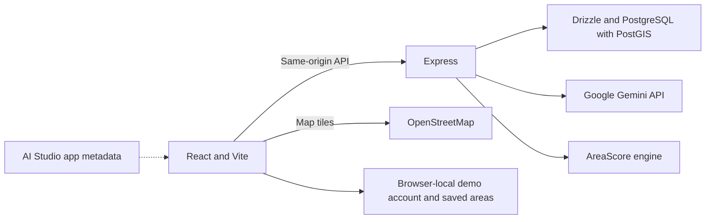

# AreaWise AI repository audit

Audit date: 22 November 2026 (IST). Baseline: `ec09428` on `origin/main` in [KunalSingh202008/AreaWise.ai](https://github.com/KunalSingh202008/AreaWise.ai/tree/ec09428). The checkout was clean and the four upstream commits were retained. Work starts on `codex/areawise-release-readiness`. A verified local Git bundle captures the baseline history.

The full uploaded master prompt was reviewed from the referenced chat attachment. The repo contains AI Studio metadata, a Firebase web app configuration, and a prior AI Studio prompt asset. AreaWise did not appear in the signed-in AI Studio account's created, recent or shared app lists or in the connected Drive search. App source, deployment revisions, secret configuration, and unsynced edits from the owning AI Studio account could therefore not be compared with Git. The prior chat reported a separate patch archive, but the archive was not present in the current workspace or retrieved chat attachments. Its earlier partial tests are excluded from this audit. The GitHub integration returned HTTP 403 for branch creation despite read metadata advertising push access. A Git CLI dry run identified the expected branch destination.

## Architecture and baseline verification

Inspected the application routes, 59 tracked paths, both migration files and journal, repositories, seed, client views, environment examples, and test suites. The baseline built with Vite and passed TypeScript. Vitest reported 23 passing and 15 failing tests. Database connection attempts could not reach PostgreSQL in that run, so the spatial, transactional and persistence claims needed an independent database run. No production deployment URL was available.

| Area | Baseline evidence | Release gap |
| --- | --- | --- |
| Startup and routing | Express serves Vite in development and `dist` in production. | Source-tree image URLs break in production. The catch-all can return HTML for API and asset misses. Development ignores `PORT`. |
| Geography, search and maps | Pilot coordinates, PostGIS geometries and radius SQL, Leaflet map. | City/state hard-coded to Varanasi/Uttar Pradesh, no national catalogue, source-level provenance missing, no verified national boundaries. |
| Scores and comparison | Methodology v1.3.0 and profile weights, with null scores below eligibility. Scoring tests pass. | README refers to 40% and v1.2.0, while current code requires 50% coverage and a 60% weight sum plus other eligibility rules. Administrative writes can mutate weights for the existing version and claim a fixed recalculation count. |
| Data and evidence | Source, observation and score tables exist. Local fixture contains source strings and static statuses. | No acquisition logs or record-level verification of publisher claims. Existing seed and generated points require quarantine from public evidence. |
| Authentication and dashboard | Firebase web configuration and SDK dependencies exist. | The client impersonates a sample user and can grant itself admin. Backend privileged routes lack authorization. Saved data stays in local storage. |
| Gemini and languages | Server SDK, interface localization for English, Hindi and Hinglish, speech support where available. | Prompt uses an in-memory evidence set. Failed Gemini requests can resemble successful AI answers. Citation provenance, conversation ownership, quotas and additional languages are incomplete. |
| Community | UI, tables, vote and moderation transactions. | Client-controlled identities, repeat voting, weak input validation, unpublished or fabricated seed items can surface. |
| Reports and B2B | Print view and an administrative UI exist. | Report source status, user-owned exports, professional workspaces, team roles and billing are incomplete. |
| Payments, operations and delivery | API scaffolding and AI Studio setup examples. | No test-mode checkout or reconciliation, release probes, verified deployment, production backups, retention or incident runbook. |

## Migration inventory

- `0000_great_hercules.sql` creates the 17 application tables and assumes PostGIS has already been enabled in the target database.
- `0001_priority1_remediations.sql` adds missing columns, relaxes role-related constraints, and adds spatial and compound indexes. It is absent from the baseline migration journal. Its new uniqueness constraints can fail if there are duplicates. Its title refers to deduplication, but the SQL does not delete duplicates.
- The seed mutates existing rows and contains historical pilot facts and community reports whose sources have not been independently established. Run only as an explicitly selected disposable test fixture.
- The original integration tests write reports, votes, audit entries, scoring weights and conversation rows. They need an isolated PostgreSQL instance with PostGIS, a fresh schema, and the legacy test fixture. They must never inherit the live app connection implicitly.

## Risk register

| Priority | Finding | Acceptance condition |
| --- | --- | --- |
| Critical | Self-assigned admin role and privileged route access. | Firebase-authenticated identity and server-enforced roles. Unauthenticated and non-admin sessions are tested. |
| High | Missing assets masked by page HTML and ambiguous startup failure. | Built JS/CSS and all bundled pilot images return correct content types. Missing resources have correct status and API response. |
| High | Pilot records and static telemetry can appear publicly verified. | Public surfaces consume traceable evidence and label coverage, provenance and missing data. |
| High | Drift between migration journal, runtime schema and existing data. | Fresh PostGIS run, inventory, backups and duplicate checks before any approved live change. |
| High | Model outage and draft response data can resemble a live answer. | Model status, bound citations, bounded budgets, user-owned storage and a separate no-credential test. |
| High | Community abuse and casual storage of personal details. | Signed writes, per-user vote uniqueness, public moderation filters and limited logging. |
| Launch gate | Payments, entitlement integrity and cost. | Provider-issued test credentials, verified raw-body webhooks, replay and state-transition tests, no live mode. |

## Milestones and dependencies

1. Preserve history and identify the AI Studio/GitHub sync gap. Access to the owning AI Studio app or a timestamped code export is required for a real sync comparison.
2. Repair routing, images and startup. Build and test against the real application and a disposable PostgreSQL/PostGIS database.
3. Add public India discovery with attributed source snapshots, nullable evidence and safe search. Validate pilot observations against source documents before publication.
4. Replace demo identity and protect user, community and admin operations. Verify Firebase claims locally, then verify deployed OAuth settings with project access.
5. Connect the Copilot to source records and establish a live test with an existing Gemini credential and approved quota. Add reports and professional evidence export.
6. Exercise subscriptions and checkout in Razorpay Test Mode. Merchant test access, plan IDs and webhook secret are required for a provider-backed run.
7. Verify staging builds, migrations on a restored copy, restore procedures, alerting, capacity, data licensing, user terms and launch gates.

No new paid resources are required for the isolated build and tests. Hosting, SQL, optional map tiles/storage, Gemini requests and payment fees depend on region, capacity and provider agreement. The release report records cost assumptions separately. Applying live schema changes, updating scoring methodology, enabling payment collection and deploying to production require founder approval.
